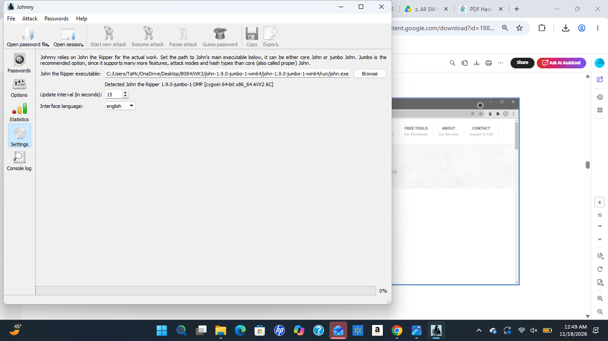
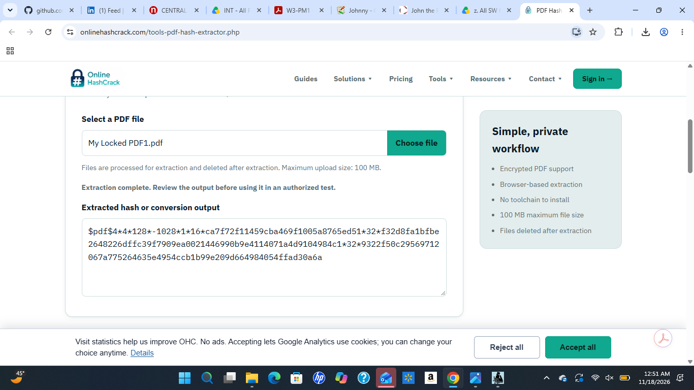
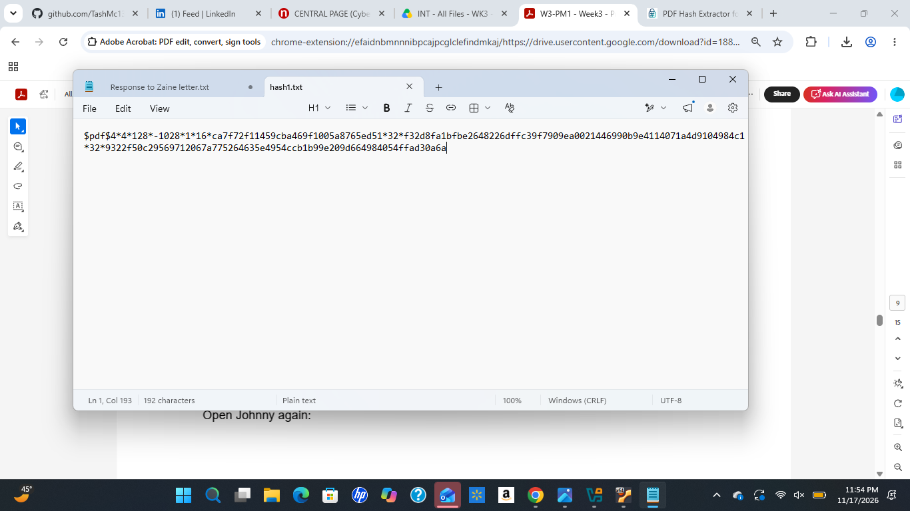
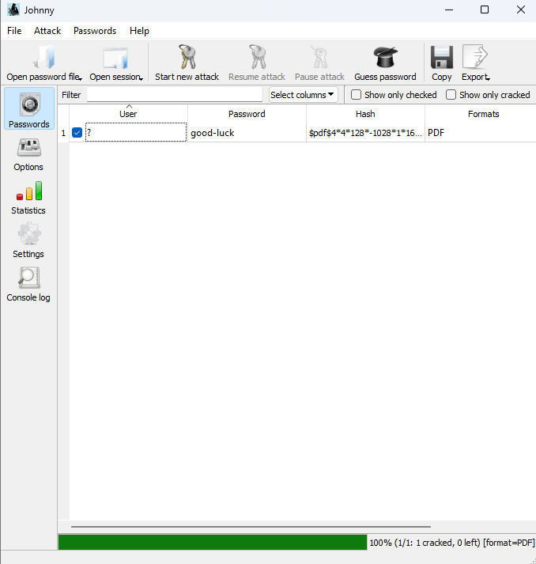
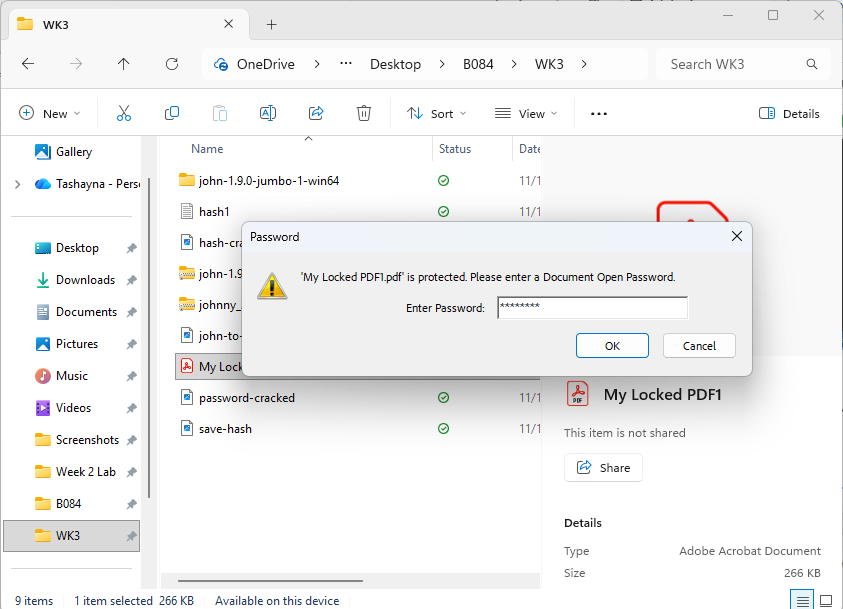
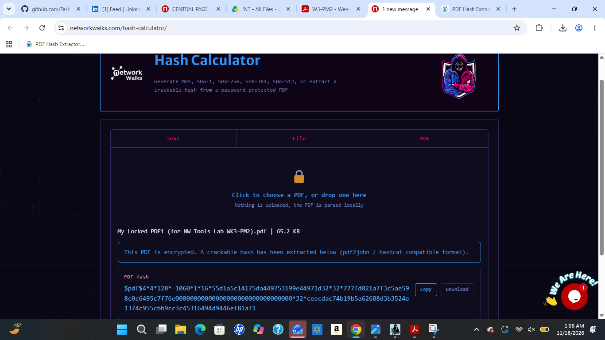
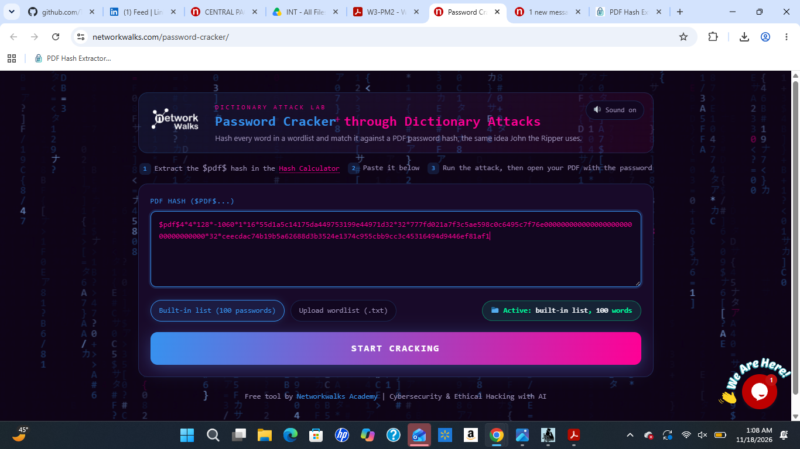
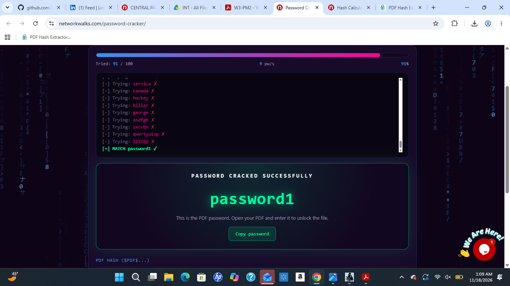
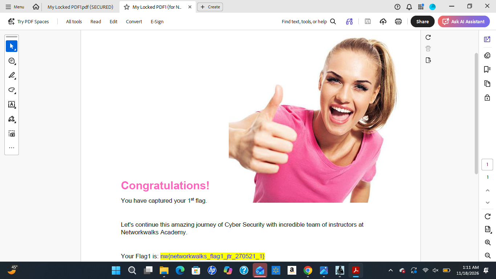

# WK3 Encrypted Document Recovery & Password Cracking Lab

## Networkwalks Cybersecurity Internship | Lab Documentation
----------------------------------------------------------
## PM 1

| Field | Details |
| :--- | :--- |
| **Pentester / Author** | Tashayna McIntosh |
| **Program / Batch** | B084 - Networkwalks Internship |
| **Lab Focus** | Password Cracking & Encrypted PDF Document Recovery |
| **Operating System** | Windows |
| **Primary Tools** | John the Ripper, Networkwalkscracker |
| **Target Files** | Password-Protected PDF Modules (Networkwalks Internship) |
-----------------------------------------------------------------------------------------

## 1. Liability Disclaimer
All activities, commands, and methodologies documented within this repository were conducted solely inside an isolated, authorized virtual lab environment for educational, research, and skill-development purposes as part of the Networkwalks Cybersecurity Internship.
The primary purpose of this documentation is to demonstrate defensive password security principles, hash extraction techniques, and offline recovery mechanics for authorized systems. Performing unauthorized access attempts, dictionary attacks, or password recovery against files, networks, or devices without explicit written permission from the legal owner is illegal and punishable under international cybercrime laws. The instructor, authors, and Networkwalks Academy assume no liability for individual misuse or misinterpretation of these materials.
----------------------------------------------------------------------------------------------------------------------------------------

## 2. Executive Overview
Password cracking and offline hash recovery are fundamental competencies in ethical hacking and penetration testing. During this lab module of the Networkwalks Cybersecurity Internship, each module provided a locked, password-protected PDF file containing project criteria and target assets.
The objective of this assessment was to extract the cryptographic hashes embedded within each locked PDF header, recover the original passphrases, and unlock the document contents to proceed with subsequent internship tasks.

Objectives
Extract cryptographic hashes from locked PDF files without altering file integrity.
Execute CPU- and GPU-accelerated dictionary attacks using John the Ripper and Networkwalkscracker.
Decrypt the locked PDF documents to verify recovery accuracy and access module documentation.
---------------------------------------------------------------------------------------------------------

## 3. Environment & Prerequisites
The lab environment was configured using standard security distribution tools:
John the Ripper (JtR): Used for initial password hash cracking and format conversion scripts (pdfhashextractor.com).

---------------------------------------------------------------------------------------------------------------------------

## 4. Step-by-Step Lab Execution
Hash Extraction from Locked PDF Files
Before initiating an offline password cracking attack, the cryptographic hash corresponding to the document's encryption key must be extracted from the PDF structure.

Located the locked module PDF file in the working directory:
"C:\Users\TaMc\Downloads\B084\WK3\My Locked PDF2.pdf"

-Executed pdfhashextractor which extracts the format used by pdf2john and pdf2hashcat to process the PDF security handler and generate a compatible John the Ripper hash string
-Verified the structure of the extracted hash file:

   ## 👩🏾‍💻Module 1- Extracting PDF Hash
Observation: The output confirmed an standard $pdf$ hash format containing revision details, key length, and salt bytes required for offline cracking.

   ## ⚔️Module 2 - John the Ripper Attack Execution
Observation: John the Ripper evaluated the candidate passwords against the PDF hash algorithms, successfully matching the hash to a plaintext password within seconds due to wordlist alignment.

   ## 🔓Module 3. Decrypting & Unlocking PDF Content
Once the plain-text credentials were recovered for each module, the files were permanently decrypted to access project directives.
Decrypted the PDF file using the password provided by JTR

Verified document accessibility and content integrity:

   ## 🔓Module 4 - Unlocked PDF Document Verification
Observation: The PDF file opened without prompting for authentication, allowing complete access.

---------------------------------------------------------------------------------------------------------------------------------------

## 🛡️5. Defensive Recommendations
Based on the findings from this lab, standard password protection on PDF documents can easily be bypassed if underlying passphrases are simple or short. Organizations should implement the following security measures:

🖋️Use AES-256 Bit Encryption: Ensure PDF documents are encrypted using Adobe Acrobat X or newer (AES-256), which significantly reduces hash evaluation speed during offline brute-force attempts.
🖋️Enforce Long Passphrases: Utilize passphrases of at least 16+ characters combining multiple word groups to defeat dictionary and rule-based attacks.
🖋️Implement Document Rights Management (DRM): For sensitive enterprise documents, deploy centralized DRM solutions rather than relying solely on static password protection.
----------------------------------------------------------------------------------------------------------------------------------------

# PM2- PASSWORD CRACKING USING NETWORKWALKS TOOLS
---------------------------------------------------------
## 1️⃣Locked file downloaded to Windows PC, Network walks hash calculator accessed.

## 2️⃣File uploaded to hash calculator and hash file generated.
   

## 3️⃣ Text file copied and pasted into Networkwalks password cracker; password generated after multiple combinations tried.
   

    

## 4️⃣Password cracking successful.
   
----------------------------------------------------------------------------------------------------------------------------------

## 6. Author & Program Information

Pentester: Tashayna McIntosh

Role: Cybersecurity Intern

Batch: B084 - Networkwalks

Program: Cybersecurity & Ethical Hacking Internship

LinkedIn: www.linkedin.com/in/tashayna-mcintosh-003661266 

